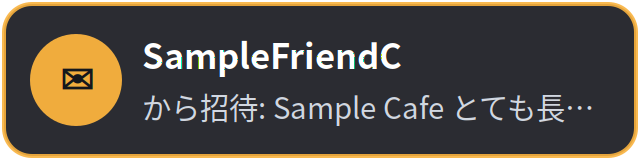
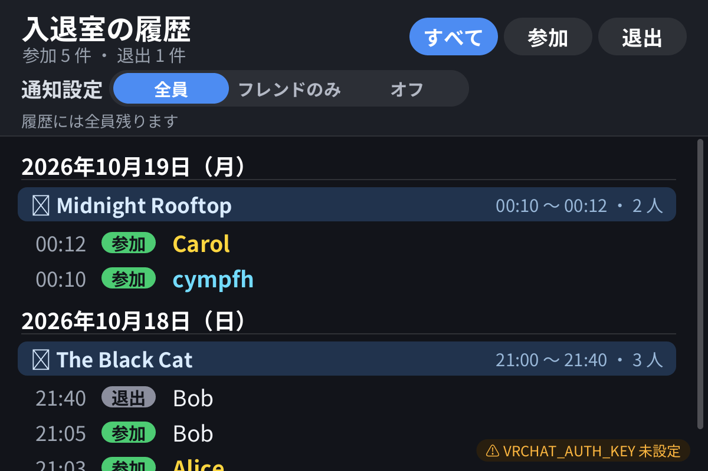

# vrc-wrist-notifier

VRChat で **だれかが来た・帰った、ワールドを移動した、招待やフレンド申請が届いた** ときに、
Steam Frame の視界に小さなカードを数秒だけ出します。メニューを開かなくても気づけます。




あとから **だれがいつ来て帰ったか** を、SteamVR のダッシュボードで日付・ワールドごとに見返せます。



VRChat を動かす Windows PC と Steam Frame の両方に入れます（同じ家の LAN の中だけで通信します）。

## インストール

**Steam Frame**: Konsole に貼り付けて Enter

```sh
curl -fsSL https://raw.githubusercontent.com/cympfh/vrc-wrist-notifier/main/frame/install.sh | bash
```

**Windows PC**: PowerShell に貼り付けて Enter

```powershell
irm https://raw.githubusercontent.com/cympfh/vrc-wrist-notifier/main/windows/install.ps1 | iex
```

## オン・オフ

Frame 側（表示する係）:

```sh
systemctl --user enable --now vrc-wrist-notifier    # オン（次からは自動で起動）
systemctl --user disable --now vrc-wrist-notifier   # オフ
```

Windows 側（VRChat のログを見る係）は、使うときに PowerShell で起動し、終わったらそのウィンドウで Ctrl+C:

```powershell
powershell -ExecutionPolicy Bypass -File "$env:LOCALAPPDATA\vrc-wrist-notifier\vrc-wrist-notifier.ps1"
```

うまくつながったかは、最後に ` -Test` を付けて起動すると、テストのカードが 1 枚出ることで確かめられます。

## 履歴を見る

Frame 側が動いているあいだ、SteamVR のダッシュボード（メニューボタン）の下の並びに **「入退室の履歴」** のアイコンが出ます。
選ぶと、新しい順の一覧が開きます。上の「すべて・参加・退出」で絞り込み、スティックかドラッグでスクロールできます。

- 履歴は Frame の中（`~/.local/state/vrc-wrist-notifier/`）だけに保存されます。人の名前が入るので、どこにも送りません
- Windows 側を起動すると、PC に残っている VRChat のログからも履歴を読み込みます（同じものは 1 回だけ）

## VRChat の準備

- VRChat のクイックメニュー → 設定 → **Debug**（デバッグ）のログ出力を **Full** にする。Errors Only のままだと、参加・退出が記録されないので通知できません
- OSC の設定は要りません（VRChat のログファイルを読むだけ）
- Frame のホスト名が `frame` でないときは `%APPDATA%\vrc-wrist-notifier\config.json` の `frame_host` に Frame の名前か IP を書く

## アンインストール

Frame:

```sh
curl -fsSL https://raw.githubusercontent.com/cympfh/vrc-wrist-notifier/main/frame/install.sh | bash -s -- --uninstall
```

Windows:

```powershell
& ([scriptblock]::Create((irm https://raw.githubusercontent.com/cympfh/vrc-wrist-notifier/main/windows/install.ps1))) -Uninstall
```

外したファイルは消さずに `~/.local/share/vrc-wrist-notifier-uninstalled/`（Windows は `%LOCALAPPDATA%\vrc-wrist-notifier-uninstalled\`）へ移します。設定ファイルと履歴は残ります。

<details>
<summary>くわしい情報（設定・開発者向け）</summary>

- 設定: Frame は `~/.config/vrc-wrist-notifier/config.ini`、Windows は `%APPDATA%\vrc-wrist-notifier\config.json`（どちらも初回にサンプルからコピー）。項目は [docs/DEVELOPMENT.md](docs/DEVELOPMENT.md)
- 表示場所は視界の少し下（既定）か、左右の手首（`anchor = left_wrist`）を選べます
- [frame-care](https://github.com/cympfh/frame-care)（休憩・電池・温度のお知らせ）のカードも表示します。急ぎは赤、注意は琥珀、ふつうは青緑
- ワールドに入った直後の 10 秒は、元からいた人の「参加」を出しません
- ログ: `journalctl --user -u vrc-wrist-notifier -f`
- 通信は UDP ポート 39570 の OSC（`/wrist/notify`）。Frame 側は家の LAN からのものだけ受け付けます
- Windows 側はファイルを読むだけで、管理者権限・追加ソフト・自動起動は使いません

</details>

ほかの Steam Frame 用ツール: [frame-tools](https://github.com/cympfh/frame-tools)
